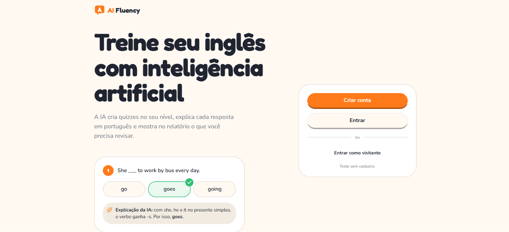
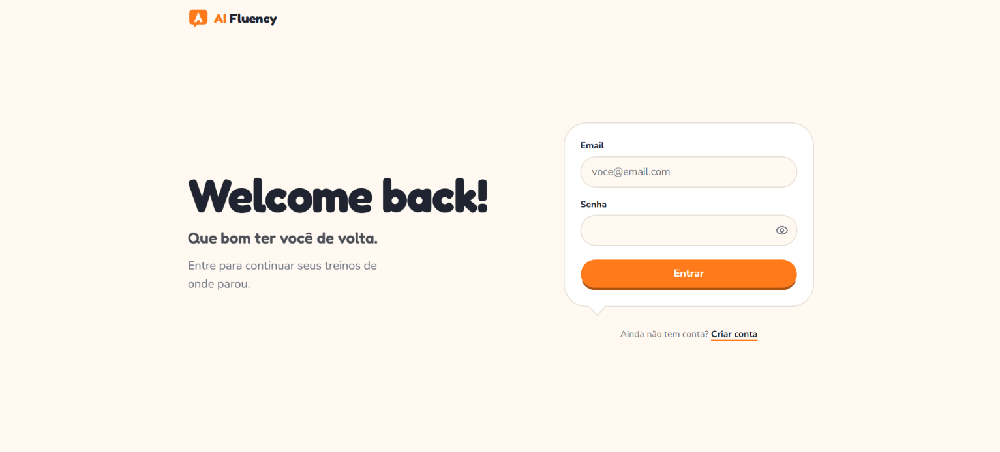
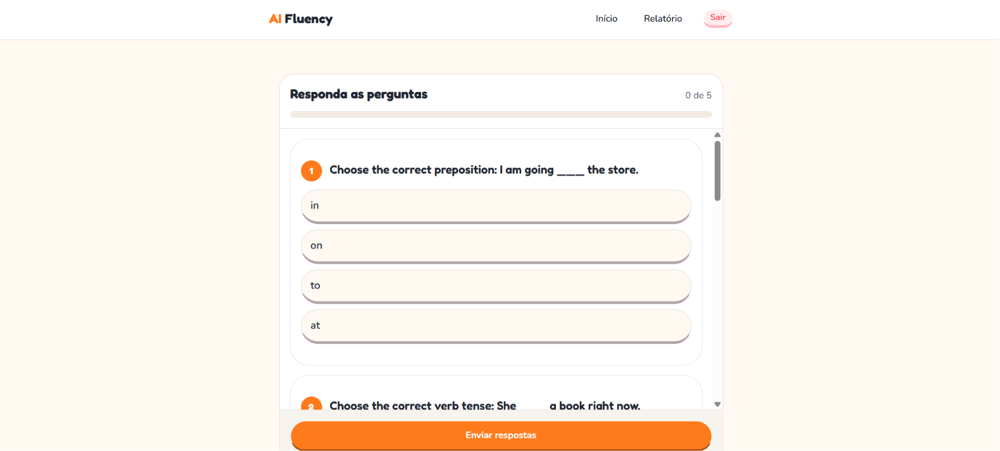
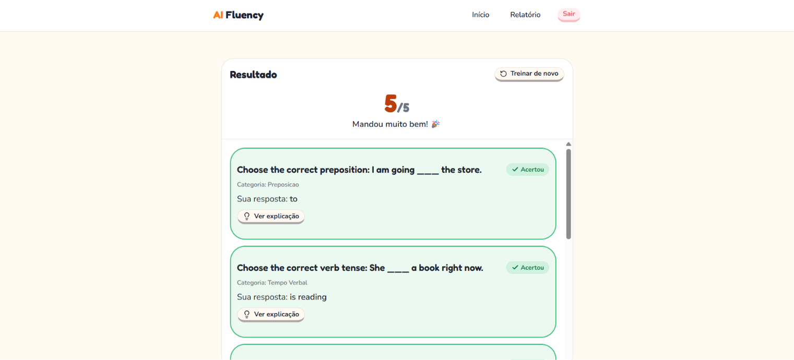
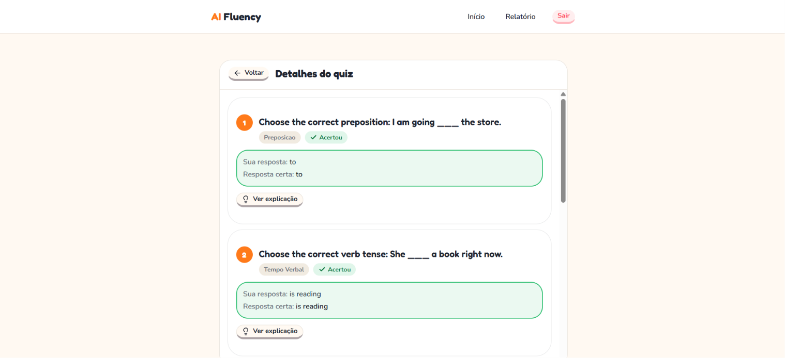

# AI Fluency 🇬🇧

Treinador de inglês full-stack com quiz e feedback gerados por IA — a nota é sempre calculada no servidor, a partir do gabarito que está no banco, nunca de dado enviado pelo cliente.

🔗 Demo: https://app-ingles-bay.vercel.app — dá pra testar sem cadastro pelo botão **Entrar como visitante**
📦 Repo: https://github.com/Americanoooo/app-ingles



---

## Problema / Motivação

Depois do primeiro projeto de portfólio, eu queria sair da minha zona de conforto num ponto específico: nunca tinha me aprofundado em consumir uma API externa de verdade. IA generativa encaixou perfeitamente nessa meta — dava pra construir algo útil (um treino de inglês) enquanto aprendia, de ponta a ponta, a integrar com um provedor de IA: da chamada ao modelo até validar e persistir com segurança o que ele devolve.

---

## ✨ Funcionalidades

- **Landing page** — página pública de apresentação em `/`, com prévia de uma pergunta e da explicação da IA; quem já tem sessão válida é redirecionado direto para o treino.
- **Autenticação completa** — cadastro e login com senha criptografada e sessão via cookie httpOnly (proteção contra roubo de token via XSS).

  

- **Modo visitante** — o botão "Entrar como visitante" cria uma sessão numa conta compartilhada (criada pelo `schema.sql`), para quem quer testar sem se cadastrar.

- **Autorização por dono (anti-IDOR)** — cada usuário só vê os próprios quizzes; id de outro dono na URL não vaza dado (404 genérico, também anti-enumeração).
- **Rate limiting** — limites por IP nas rotas públicas (login/cadastro) e por usuário nas autenticadas, com contadores independentes para as rotas que chamam a IA (mais caras) e para o restante.
- **Geração de quiz por IA** — escolha de dificuldade e quantidade de perguntas; a IA gera questões de múltipla escolha nas categorias *preposição*, *tempo verbal* e *contexto*.

  

- **Correção no servidor** — o quiz é persistido no momento da geração e corrigido contra o gabarito do banco, dentro de uma transação. Cada quiz só pode ser respondido uma vez, e cada resposta precisa ser uma das opções da pergunta.
- **Tela de resultado** — acertos destacados visualmente (verde/vermelho), com a resposta correta revelada apenas nas perguntas erradas.

  

- **Feedback por pergunta** — explicação gerada por IA, em português, do porquê da resposta correta. O cliente envia só o id da pergunta; enunciado e respostas saem do banco.
- **Histórico de quizzes** — relatório com filtros por dificuldade e período; revisão pergunta a pergunta de um quiz antigo.

  

- **Limpeza automática** — rotina agendada diariamente remove quizzes gerados e nunca respondidos (consequência assumida do fluxo de persistir antes de corrigir) e zera o histórico da conta de visitante.

---

## 🛠️ Tecnologias

**Front-end:** Next.js 16 (App Router) · React · TypeScript · Tailwind CSS + shadcn/ui
**Back-end:** Next.js Route Handlers + Proxy (antigo middleware) · MySQL + Prisma 7 (adapter MariaDB) · Zod · bcrypt · jose (JWT em cookie httpOnly)
**IA:** Google Gemini (endpoint compatível com OpenAI), saída estruturada via `json_schema`
**Infraestrutura:** Docker + Docker Compose · Upstash Redis (rate limiting) · Vercel Cron · Deploy: Vercel (app) + Aiven (MySQL)

---

## 🧠 Destaques de arquitetura

**Falha de segurança que eu encontrei e corrigi: nota forjável pelo cliente.** Na primeira versão, o quiz só era gravado quando o usuário respondia — o que significa que, na hora de corrigir, o `/api/responder` recebia a resposta certa de cada pergunta no mesmo body que o cliente reenviava. O servidor até calculava a nota (o cliente não mandava `acertou: true`), mas comparava **dois valores que o próprio cliente controlava**: bastava abrir o DevTools, ler o gabarito e reenviar `respostaUsuario = respostaCerta` pra forçar 10/10.

A correção mudou o fluxo: `/api/gerar-perguntas` passou a persistir quiz e perguntas (com o gabarito) no momento da geração, dentro de uma transação, e devolve pro front apenas `quizId`, os ids das perguntas, enunciados e opções — a resposta certa nunca sai do servidor. O `/api/responder` recebe só `quizId` e os pares `{perguntaId, respostaUsuario}`, busca o gabarito real no banco com checagem de dono (JOIN por `usuario_id`), calcula acerto e nota, e faz o UPDATE. Nada que o cliente envie participa da decisão do que é certo — e, de quebra, o gabarito deixou de ficar visível no DevTools durante o quiz.

**Fechando as brechas que sobraram no mesmo fluxo.** Com o gabarito no servidor, ainda dava pra abusar das rotas de outras formas, e cada uma ganhou uma regra própria:

- **Resposta fora das opções.** O `/api/responder` rejeita qualquer `respostaUsuario` que não esteja entre as opções gravadas para aquela pergunta — o banco só recebe respostas que o usuário poderia ter clicado.
- **Responder o mesmo quiz duas vezes.** A busca do quiz e o `UPDATE` da nota exigem `nota IS NULL`. Se duas requisições chegarem juntas, só uma consegue atualizar a linha (`affectedRows === 0` na outra, que faz rollback e devolve 404). A checagem fica no próprio `UPDATE`, e não num `SELECT` anterior, justamente para não abrir uma janela entre ler e gravar.
- **Prompt controlado pelo cliente.** O `/api/feedback` recebia enunciado e respostas no body e montava o prompt com eles — qualquer um podia usar a rota como um proxy gratuito para o Gemini, com o texto que quisesse. Agora a rota recebe só o `perguntaId` e busca a pergunta no banco, filtrando pelo dono e por quizzes já respondidos.

**Trade-off que eu aceitei conscientemente, e o que fiz com ele.** Persistir o quiz antes de existir resposta significa aceitar linhas incompletas no banco: `nota`, `resposta_usuario` e `acertou` nascem nulos e só são preenchidos quando o usuário envia. Além de exigir que essas colunas fossem nullable, isso cria um efeito colateral: quizzes gerados e nunca respondidos ficam guardados. A alternativa (segurar tudo em memória até o envio) manteria o banco limpo, mas não sobrevive a um ambiente serverless, onde a próxima requisição pode cair em outra instância. Escolhi o dado incompleto em vez da falha de segurança, e lidei com as consequências em dois lugares: o relatório filtra por `nota IS NOT NULL`, e uma rotina agendada apaga os abandonados.

**A rotina de limpeza.** É uma rota (`/api/limpeza`) invocada por um Vercel Cron uma vez por dia. Faz duas coisas: apaga quizzes abandonados de todos os usuários e zera o histórico da conta de visitante. Quatro decisões que valem explicação:

- **Autenticação por segredo compartilhado, não por sessão.** O cron é um robô e não tem cookie, então a rota compara o header `Authorization` com a variável `CRON_SECRET` — e por isso ela também fica de fora do matcher do proxy, que exige sessão. São dois mecanismos de identidade para dois tipos de cliente. Se `CRON_SECRET` não estiver definida, a rota recusa tudo em vez de aceitar um header vazio.
- **Abandonados sem transação, de propósito.** A ordem importa (perguntas antes de quiz, por causa da FK), mas uma falha no meio deixa apenas quizzes sem perguntas, que continuam batendo no critério de abandonado e somem na execução seguinte. Falha parcial que se autocorrige não precisa de transação; o `criarQuiz`, onde o estado intermediário seria visível para o usuário, precisa.
- **Visitante com transação.** Já a limpeza do visitante apaga quizzes **respondidos**, que não batem em critério nenhum na execução seguinte: se falhasse entre as perguntas e os quizzes, sobrariam quizzes sem perguntas aparecendo no relatório. Aqui o estado intermediário é visível, então as duas exclusões rodam numa transação.
- **Margem no critério, e um bug que ela escondia.** A coluna `data` guarda só o dia, sem hora, então "abandonado" precisa ser definido em dias. A primeira versão apagava tudo que fosse anterior ao dia corrente, achando que isso protegia quem estava respondendo — mas um quiz começado às 23h já é "de ontem" quando o cron roda à 01h, e seria apagado no meio da resposta. Hoje o corte é anterior a ontem: todo quiz sobrevive pelo menos 25h antes de ser considerado abandonado. O "hoje" é calculado no código, no fuso de São Paulo, e não com o `CURDATE()` do MySQL, para a regra não depender do fuso configurado no servidor do banco.

**Saída estruturada da IA (`json_schema`).** Resposta de LLM em texto livre é inconsistente na prática — e isso não é só estética: um parse que falha vira bug real na experiência do usuário (quiz não carrega, feedback trava). Por isso a geração das perguntas e o feedback por pergunta usam saída estruturada (`json_schema`, na chamada compatível com OpenAI ao Gemini) — o schema trava os campos que a IA precisa devolver, então o código lê cada um com confiança em vez de tentar adivinhar texto solto. Como camada extra, a resposta ainda passa por validação com Zod antes de qualquer gravação no banco — defesa em profundidade: o schema garante o formato na saída do LLM, o Zod garante que o que chega no back-end bate com o que o banco espera, mesmo que o provedor mude de comportamento.

**Persistência atômica.** Quiz e perguntas precisam ser gravados como uma unidade: se a inserção de uma pergunta falhar no meio do caminho, sobra um quiz órfão no banco. No `criarQuiz`, quiz e perguntas vão num único `create` com escrita aninhada, que o Prisma executa de forma atômica. No `atualizarQuiz`, a transação é interativa (`prisma.$transaction(async (tx) => …)`) porque precisa decidir no meio do caminho: se o UPDATE do quiz não encontrou nada (já respondido ou de outro usuário), lança erro e desfaz tudo. A regra que mais importa ali é usar sempre o `tx` dentro do callback, nunca o `prisma` — uma query feita pelo `prisma` roda em outra conexão, fora da transação, e o rollback não teria efeito nenhum sobre ela. Quando as operações são uma sequência fixa, sem decisão no meio (como a limpeza do visitante), uso a forma em array, `prisma.$transaction([...])`.

**Uma convenção de nomes, convertida num lugar só.** O banco usa snake_case e o restante da aplicação usa camelCase. A conversão acontece dentro dos models (`lib/models/*.model.ts`), logo depois da query — no caso das perguntas, numa função só (`paraPerguntaQuiz`) usada por todas as buscas: rotas e front nunca veem nome de coluna. Antes disso, uma rota devolvia a linha crua do banco enquanto outras já convertiam, e o mesmo dado chegava com dois formatos diferentes dependendo da tela — origem de vários bugs silenciosos, porque o TypeScript não acusa quando a interface descreve um formato que o dado real não tem.

**Erro tratado por camada.** O model lança, a rota traduz para HTTP e o front exibe. As funções em `lib/respostas.ts` concentram os status e as mensagens voltadas ao usuário; o detalhe técnico vai só para o log. No cliente, o `apiFetch` converte qualquer resposta com status de erro em um `ApiError` que carrega status e mensagem, e a tela usa `instanceof` para distinguir "o servidor respondeu com erro" de "a requisição nem chegou lá" — só no primeiro caso a mensagem do backend é exibida. No proxy (`proxy.ts`, o antigo middleware do Next.js), a mesma ideia separa o que é falha de autenticação (bloqueia) do que é falha de infraestrutura do rate limit (registra no log e deixa passar).

---

## 🚀 Como rodar

### Opção 1 — Docker (recomendado)

**Pré-requisitos:** Docker instalado.

```bash
git clone https://github.com/Americanoooo/app-ingles.git
cd app-ingles
# crie o .env (veja "Variáveis de ambiente")
docker compose up --build
```

Acesse http://localhost:3001 — o schema do banco (incluindo a conta de visitante) é criado automaticamente na primeira execução. O MySQL do container fica exposto na porta 3307 do host.

### Opção 2 — Local

**Pré-requisitos:** Node.js, MySQL local com o schema criado (`schema.sql`).

```bash
npm install
npx prisma generate   # gera o client do Prisma em lib/generated (fica fora do git)
# configure o .env apontando pro seu MySQL local
npm run dev
```

Acesse http://localhost:3000.

## 🔑 Variáveis de ambiente

```env
DB_HOST=localhost          # use "db" ao rodar via Docker Compose
DB_USER=root
DB_PASSWORD=sua_senha
DB_NAME=app_ingles
DB_PORT=3306
JWT_SECRET=uma_chave_secreta_longa
GEMINI_API_KEY=sua_chave_do_gemini
UPSTASH_REDIS_REST_URL=url_do_seu_redis
UPSTASH_REDIS_REST_TOKEN=token_do_seu_redis
CRON_SECRET=string_aleatoria_longa   # autentica a rota de limpeza
```

> O `.env` está no `.gitignore` e não é versionado. A chave do Gemini é gratuita no Google AI Studio.

---

## 📁 Estrutura

```
app/
├── page.tsx          # landing page (pública)
├── (auth)/           # login/cadastro (público)
├── (app)/            # treino, relatório (autenticado) + layout com Navbar
├── api/              # route handlers
├── components/       # componentes do app (AuthGuard, Navbar, landing/…)
├── opengraph-image.tsx  # imagem de compartilhamento gerada no build
components/
├── ui/               # shadcn/ui
lib/
├── models/           # acesso ao banco via Prisma + conversão snake_case → camelCase
├── prisma.ts         # client do Prisma (adapter MariaDB)
└── …                 # sessão, respostas HTTP, datas, rate limit
prisma/schema.prisma  # modelos do banco
prisma.config.ts      # config da CLI do Prisma
proxy.ts              # sessão + rate limit das rotas de API (antigo middleware)
schema.sql            # estrutura do banco + conta de visitante
vercel.json           # agendamento do cron de limpeza
docker-compose.yml
dockerfile
```

---

## 🗺️ Roadmap

- **Modo adaptativo** — gerar perguntas focadas nas categorias que o usuário mais erra, lendo o histórico de acertos.
- **`data` como DATETIME** — hoje a coluna guarda só o dia, o que limita a ordenação do histórico e obriga a limpeza a esperar pelo menos 25h para considerar um quiz abandonado.

---

## Autor

**Cauã Americano** — [GitHub](https://github.com/Americanoooo) · [LinkedIn](https://www.linkedin.com/in/cau%C3%A3-americano-19a4012a5/)

---

## English summary

Full-stack English trainer with AI-generated quizzes and per-question feedback (Next.js 16 App Router, TypeScript, MySQL via Prisma 7), with a public landing page and a guest mode for trying it without signing up. The server is the single source of truth for scoring: quizzes and questions — including the correct answers — are persisted when the quiz is generated, and `/api/responder` grades submissions against the database instead of trusting anything the client sends back. This closed a real vulnerability in v1, where the answer key round-tripped through the client and a forged 10/10 was possible from DevTools. The same flow also rejects answers that aren't among the question's options, blocks answering a quiz twice (the check lives in the `UPDATE` itself, so concurrent requests can't both win), and the feedback route receives only a question id and builds the prompt from the database, so the client can't drive the LLM. The accepted trade-off — rows that start incomplete, and abandoned quizzes that pile up — is handled by a daily Vercel Cron cleanup route, authenticated by a shared secret rather than by session, which also wipes the shared guest account's history. Questions and feedback come from Google Gemini (OpenAI-compatible endpoint) using structured output (`json_schema`), validated again with Zod before reaching the database. Multi-step writes run inside Prisma transactions, so a failure halfway leaves nothing behind. Session auth via httpOnly cookie (`jose`); ownership-based authorization prevents IDOR across users' quiz history; rate limiting is applied per IP on public routes and per user on authenticated ones.

Demo: https://app-ingles-bay.vercel.app · Repo: github.com/Americanoooo/app-ingles
